<p align="center">
  
</p>

# fynepdf-grayscale

**Make PDFs grey in place: text stays text, nothing is redrawn.** A C++17 library and command line
on [qpdf](https://github.com/qpdf/qpdf), MIT licensed, with no Ghostscript.
Made by [FynePDF](https://fynepdf.com) for its web and desktop apps.

- **Every colour, where it is:** text and drawing colours, pictures, palettes, gradients,
  patterns, spot inks, soft masks, and the appearances of comments and form fields.
- **Nothing else changes:** text stays selectable and searchable, and bookmarks, links, form
  fields, tags and attachments aren't touched.
- **Photos keep their quality:** most JPEGs are made grey without re-compressing them (their
  brightness kept exactly, their colour dropped); files come out about the same size (median
  0.94× the input).
- **Choose what turns grey:** some pages only, or only text and drawings (photos keep their
  colour), or only pictures.
- **Light:** a typical file takes 0.01 s and 12 MB; the heaviest of 1,067 took 3.5 s and 255 MB.

## Results

On the same 1,067 files (1,000 PDFs from the web and 67 made for the tests):

| | Colour left | Text lost | Files that lost something | Median size | Total time | Most memory |
| --- | --- | --- | --- | --- | --- | --- |
| **fynepdf-grayscale** | **0** | **0** | **0** | 0.94× | **78 s** | **255 MB** |
| Ghostscript 10.08 | 5 | 40 | 370 | 0.64× | 1,038 s | 1.4 GB |
| Pages drawn as grey pictures | 0 | 950 (all) | 593 | 4.46× | 705 s | 655 MB |

"Lost" means bookmarks, links, form fields, tags, comments, attachments or signatures the input
had and the result doesn't. Ghostscript's files are smaller because it re-compresses every
picture and drops what it doesn't carry over. Details and real files: [docs/benchmarks.md](docs/benchmarks.md).

## Use it

### From the command line

```sh
npx fynepdf-grayscale input.pdf output.pdf                    # every page
npx fynepdf-grayscale input.pdf output.pdf --pages 2-5,8      # only these pages
npx fynepdf-grayscale input.pdf output.pdf --only drawings    # text and drawings grey, photos in colour
npx fynepdf-grayscale input.pdf output.pdf --only images      # photos grey, text and drawings in colour
```

Through npm it runs on Linux (x64, arm64), Windows (x64) and macOS (Apple silicon, Intel), with
nothing to build. Or download your platform's archive from
[Releases](https://github.com/birazzzz/fynepdf-grayscale/releases): one program, ready to run as
`./fynepdf-grayscale input.pdf output.pdf`.

It prints what it did as one line of JSON:

```json
{"ok":true,"pages":4,"converted":4,"colours":212,"images":3,"jpegLossless":3,"shadings":1,"inlineImages":0,"spots":0,"imagesKept":0,"shadingsKept":0,"inlineKept":0,"contentKept":0,"wrapped":0,"signatures":0}
```

Exit codes: 0 done, 2 needs a password, 3 can't be read, 4 a page that isn't in the file, 5 can't
be written.

### From Node

```js
const { toGray } = require("fynepdf-grayscale");   // npm install fynepdf-grayscale

const result = await toGray("in.pdf", "out.pdf", { pages: [2, 3, 4], only: "drawings" });
// result.converted, result.images, ...: the JSON above
```

It rejects when the file can't be read, needs a password, lacks the pages or can't be written
(`error.code`). Types included; more in [npm/fynepdf-grayscale](npm/fynepdf-grayscale/README.md).

### From C++

```cpp
#include <fynepdf/grayscale/grayscale.h>

fynepdf::grayscale::GrayOptions options;  // everything grey, every page
options.pages = {2, 3, 4};                // or only some (1-based); the rest stay exactly as they are
// options.images = false;                // keep photos in colour

fynepdf::grayscale::GrayResult result = fynepdf::grayscale::ConvertToGray("in.pdf", "out.pdf", options);
if (!result.ok) {
  // result.error: "password", "unreadable", "pages", "write"
}
```

[examples/gray.cpp](examples/gray.cpp) is a complete program.

### In your CMake project

```cmake
include(FetchContent)
FetchContent_Declare(fynepdf_grayscale GIT_REPOSITORY https://github.com/birazzzz/fynepdf-grayscale.git GIT_TAG v0.1.0)
FetchContent_MakeAvailable(fynepdf_grayscale)

target_link_libraries(your_app PRIVATE fynepdf::grayscale)
```

Or install it (`cmake --install build`) and use `find_package(fynepdf_grayscale CONFIG REQUIRED)`.
It needs qpdf and a libjpeg from your system or [vcpkg](https://vcpkg.io) (the repository has a
`vcpkg.json`).

## Build it

You need CMake 3.16+, a C++17 compiler, qpdf 11 or newer and libjpeg-turbo. OpenJPEG (JPEG 2000
pictures) and Little CMS (ICC profiles) are optional.

```sh
# Debian or Ubuntu
sudo apt install cmake ninja-build g++ pkg-config libqpdf-dev libjpeg-dev libopenjp2-7-dev liblcms2-dev
# macOS
brew install cmake ninja qpdf jpeg-turbo openjpeg little-cms2

cmake --preset default            # Release build with tests, into build/default
cmake --build --preset default
ctest --preset default            # makes the 64 test files grey, whole, in part and by kind
```

On Windows (or anywhere) with vcpkg: set `VCPKG_ROOT` and use `--preset vcpkg` instead.

The self-contained program the releases ship (its libraries linked in from vcpkg) comes from
`node scripts/release-build.mjs <target>`, for `linux-x64`, `linux-arm64`, `win32-x64`,
`darwin-arm64` or `darwin-x64`; Linux targets build in Docker from any machine.
[RELEASING.md](RELEASING.md) has the rest.

Built and tested on Linux (Debian 12, GCC 12) and Windows (LLVM-MinGW, Clang 22). macOS and
Visual Studio builds are set up and covered by CI from the first release.

## How it works

It opens the PDF with qpdf, finds every place a colour is set (content streams, pictures,
palettes, gradients, spot inks, patterns, comment appearances) and rewrites that colour where it
stands, to luma, the brightness a JPEG stores (0.299 R + 0.587 G + 0.114 B). A picture that can't
be decoded keeps its data and gets a colour space that draws it grey. Nothing is drawn, so text
stays text and everything without colour stays byte for byte.

More: [docs/how-it-works.md](docs/how-it-works.md).

## Why FynePDF built it

[FynePDF](https://fynepdf.com)'s Grayscale ran on Ghostscript on the web, which lost text and
tags along the way, and drew pages as pictures in the desktop app, where Ghostscript's AGPL
licence can't go. Neither kept the document as it was. This keeps everything but the colour.

Sister project: [fynepdf-pdfa](https://github.com/birazzzz/fynepdf-pdfa), which makes valid PDF/A
the same way, and holds the benchmark this project is measured with.

## Licence

MIT, © 2026 FynePDF. See [THIRD-PARTY-NOTICES.md](THIRD-PARTY-NOTICES.md).
